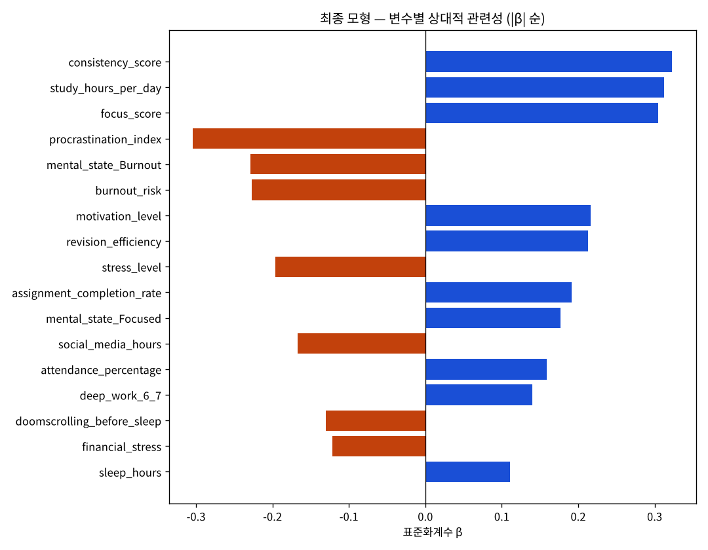

# 기말고사 성적을 설명하는 요인 분석 — 다중선형회귀

학생의 학습 습관·심리 상태·생활 습관 변수 29개가 기말고사 점수와 어떤 관계를 보이는지,
여러 변수를 함께 고려했을 때 점수 변동을 얼마나 설명하는지 다중선형회귀로 확인한 프로젝트입니다.

- 기간: 2026.07 (아이티윌 빅데이터 분석 56기 중간 프로젝트, 4인 팀)
- 데이터: Kaggle [Student Academic Performance Prediction](https://www.kaggle.com/datasets/aiexplorer77/academic-performance-prediction) (aiexplorer77, MIT) — 3,000행 × 32열 **합성 데이터**
- 도구: Python · pandas · scipy · statsmodels · matplotlib
- 발표자료: [docs/발표자료_기말고사_성적요인분석.pdf](docs/발표자료_기말고사_성적요인분석.pdf)

## 결과 요약

| | |
|---|---|
| 최종 모형 | 다중선형회귀, 설명변수 17개, n = 2,737 |
| 설명력 | R² = 0.819, adj. R² = 0.817, F(17, 2719) = 721.87 (p < .001) |
| 오차 | RMSE = 7.94점, MAE = 6.35점 |
| 가정 검정 | 선형성(RESET p = .67) · 정규성(KS p = .58) · 등분산성(BP p = .71) · 독립성(DW = 1.96) 모두 만족 |
| 가장 관련 큰 변수 (\|β\|) | 꾸준함 0.32 > 공부시간 0.31 > 집중도 0.30 ≈ 미루기 −0.30 |

- 점수와 가장 관련이 큰 변수는 전부 학생이 바꿀 수 있는 **학습 습관**이었고, 나이·성별·거주지·진로 같은 고정 변수는 모두 비유의.
- `deep_work_sessions`는 0~5회 구간은 평탄하고 6회 이상에서만 점수가 뛰는 **임계점 패턴** → 횟수 대신 "6~7회" 더미로 넣었을 때 모형이 개선 (adj. R² 0.809 → 0.817).
- 심리상태 Burnout은 Balanced 대비 9.8점 낮고 Focused는 7.7점 높음. 취침 전 스마트폰 사용 집단은 4.9점 낮음.



## 노트북

| 순서 | 파일 | 내용 | 발표자료 |
|---|---|---|---|
| 01 | `01_전처리.ipynb` | 결측 177행·24시간 초과 86행 제거, 결측 제거 전후 분포 검정 | p.10, 43 |
| 02 | `02_EDA.ipynb` | 기술통계(왜도·첨도·이상치), 명목형 분포, 산점도·박스플롯, 비선형 패턴 탐색 | p.12–16 |
| 03 | `03_추론통계.ipynb` | Spearman 상관, 독립변수 간 상관·VIF, Mann-Whitney U, 일원분산분석 + Tukey, 후보 변수 확정 | p.17–22 |
| 04 | `04_회귀분석.ipynb` | 이상치 대체 비교, 변수 표현 4개 모형 비교, 최종 모형 가정 검정, HC3 계수·표준화계수 β | p.24–33 |

위에서 아래로 순서대로 실행하면 됩니다. `dataSet/student_performance_dataset.csv`만 있으면 나머지(`student_clean.csv`, `candidate_vars.csv`, `out/`)는 다시 만들어집니다.

```bash
pip install -r requirements.txt
```

## 폴더

```
dataSet/   원본 CSV, 전처리 결과, 회귀 후보 변수 목록
out/       노트북이 만드는 표(csv)와 그림(png)
docs/      발표자료 PDF
```

## 한계

- **합성 데이터**: 독립변수끼리 상관이 거의 0(최대 |ρ| = 0.07, VIF 1.03)이라 실제 학생 데이터의 구조와 다릅니다. R² 0.82를 실제 데이터로 일반화할 수 없습니다.
- **횡단면 데이터**: 연관성이지 인과가 아닙니다. "공부시간을 1시간 늘리면 4점 오른다"는 개입 효과가 아닙니다.
- **인샘플 성능**: 변수 선택·그룹화·모형 선정·성능 계산을 같은 데이터로 했으므로 성능이 과대평가됐을 수 있습니다.
- **종속변수 절단**: 점수가 0~100으로 잘려 있어 양 끝에서 예측이 범위를 벗어납니다 (7건).

## 내 역할

데이터 품질 점검과 전처리, 추론통계(상관·집단 비교·사후검정), 회귀 모형 비교와 최종 모형 선정, 가정 검정.
이 저장소의 코드는 발표 후 처음부터 다시 정리한 것으로, 발표자료의 모든 수치를 재현합니다.
